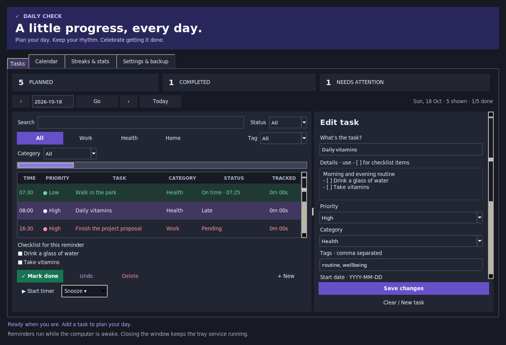

# Daily Check

A local Linux desktop planner with flexible reminders, checklists, and completion
check-ins. Built with Python, Tkinter, and SQLite. Tasks and speech stay local;
no cloud account or network service is used.



## Plan and find tasks

- **Priorities:** Low (green), Med (amber), and High (red), shown by name and color.
- **Categories and tags:** use Work, Health, Home, or your own category. Add comma-separated tags. Category buttons and category/tag selectors combine with the search and status filters.
- **Search:** matches names, descriptions, categories, and tags on the selected day. Filter All, Done, Pending (including late), or Late. Date navigation and the Calendar open other days.
- **Checklists:** add `- [ ] Checklist item` lines to the description. Each reminder gets independent checklist progress. Mark done also completes its checklist. Long lists open in a scrollable checklist window.
- **Time tracking:** select a reminder and choose Start timer / Pause timer. Only one timer runs at once; it survives closing/reopening the editor. Mark done saves elapsed time and stops that timer.

## Flexible schedules

Enter one time or up to 12 comma-separated times, for example `08:00, 20:00`.
Every time has its own check-in, snooze, checklist, and timer.

| Repeat | Behavior |
| --- | --- |
| Once | One date, with each selected reminder time |
| Every day | Daily from the start date |
| Every N days | Every 2 days, every 3 days, or another interval |
| Weekly / selected days | Pick Mon/Wed/Fri or other days; Every controls the number of weeks |
| Weekdays / Weekends | Monday–Friday or Saturday–Sunday |
| Monthly | Same day each month, or every N months; short months use their last day |

An optional **Repeat until** date is inclusive. Daily/weekly schedules are anchored
to the start date. Weekly intervals use Monday-based weeks. Times use local time.

Due unfinished reminders repeat every 15 minutes until completed or snoozed.
Missed one-time tasks remain due after restart. Repeating tasks normally remind
for the current day; an explicitly snoozed reminder remains actionable across
midnight, independently of the next day's reminder. Changing a schedule retires
old reminder slots without deleting completed check-ins.

## Notification actions and tray

Notifications offer **Done**, **Snooze 10 min**, **Snooze 1 hour**, **Tomorrow**, and
**Edit**. Tomorrow means the next calendar day at that reminder's original time.
Snoozing changes the next alert, while on-time stats retain the original due time.
Edit opens the existing task editor with the reminder-time field focused; save
your change to update the task schedule.

The native tray icon opens Daily Check. Its menu offers Open, Pause/Resume
reminders, and Quit. Closing the editor leaves the tray and reminders running.
Quit from the tray or Settings stops both. Reminders require an awake computer
and a logged-in desktop session; Do Not Disturb can silence desktop alerts.

Notification buttons require a desktop notification server that supports actions.
The tray uses the StatusNotifier protocol supported by KDE and compatible tray
hosts. Desktops without a tray host can still run the reminder service; its status
appears below the editor. Without Python GObject bindings, basic `notify-send`
reminders remain available, with snooze/check-in controls in the editor.

## Streaks, stats, and calendar

**Streaks & stats** shows current and best streaks, on-time percentages for the
current week/month, and tracked time. Choose All tasks or a specific task.

A streak counts scheduled days on which all reminders are complete. Unscheduled
days do not break it; the current day can still be completed until midnight.
On-time percentages count all reminders already due, including missed reminders,
with Monday as the start of the week. Snoozing never changes the original due
time. Statistics use the current schedule plus saved history, bounded to ten years.

The **Calendar** shows completion counts and late reminders for each day. Click a
day to see its tasks. [View the calendar](docs/images/calendar.png).

## Appearance, audio, and focus mode

Settings offers **Dark**, **Light**, and **System** appearance. System reads KDE's
configured window colors or GNOME's color-scheme preference when available.

Choose `system` for the desktop's default notification sound, leave it blank for
silence, or browse to an audio file. The desktop notification server handles sound;
Preview uses local `paplay` or `ffplay`. Optional speech reads reminder titles with
local eSpeak NG/eSpeak. Speech is off by default.

Enable **Focus mode** per task and set how many minutes before/after a reminder
check-in is allowed. The same rule applies in the editor and notification actions.
Snoozing moves the focus window. Settings can also block notification check-ins
while the desktop reports the screen locked. Unsupported lock-state interfaces
cannot provide that guard. These are task-workflow controls, not an OS lock.

## Requirements and run

- Python 3 with Tkinter and SQLite support.
- A Linux graphical desktop session.
- Python GObject bindings (`gi`, with Gio/GLib) for notification actions and tray support.
- `notify-send` for the basic fallback; eSpeak NG/eSpeak for optional speech.
- `paplay` or `ffplay` for sound previews; the notification server handles reminder sounds.

Use your distribution's **system Python**, which can see its Tkinter/GObject
packages, rather than an isolated environment without those packages.

```sh
git clone https://github.com/danny19862025/dailycheck.git
cd dailycheck
/usr/bin/python3 app.py
```

Install the application-menu launcher for this checkout:

```sh
/usr/bin/python3 install.py
```

The installer preserves your existing login-startup preference and updates old
Daily Check launcher paths. To explicitly change login startup:

```sh
/usr/bin/python3 install.py --autostart
/usr/bin/python3 install.py --no-autostart
```

Launchers use absolute paths: keep the checkout where it was installed, or rerun
the installer after moving it. The included `.desktop` file is a manual template;
`install.py` writes a ready-to-use version. Launching the app again reuses its
editor. `app.py --reminders` runs just the tray/reminder service.

Keyboard shortcuts: **Ctrl+N** new task, **Ctrl+S** save, **Ctrl+F** search.

## Data, backup, and import/export

Tasks and check-ins live in `~/.local/share/daily-check/tasks.sqlite3`, or
`$XDG_DATA_HOME/daily-check/tasks.sqlite3`. Descriptions are stored locally without
encryption and may appear in notifications or be read aloud if speech is enabled.
Personal databases, logs, local exports, and Python caches are excluded from Git.

- **JSON export/import:** task definitions, schedules, checklist definitions, and saved check-ins. Active timers are frozen at export time; importing never starts a timer.
- **CSV export/import:** task definitions and schedules, without check-in history. Use Daily Check's exported column format.
- **Imports add copies.** Existing tasks stay. Importing the same file twice creates duplicates. Invalid imports are rejected before adding tasks, and each import gets a pre-import backup.
- **Back up now:** saves a consistent SQLite snapshot to your chosen location.
- **Daily backups:** the app or reminder service saves one snapshot per local day, retaining 30 days under the database's `backups/` directory. No backup runs while both app and service are stopped.
- **Upgrades:** the original database gets a `before-upgrade-…sqlite3` backup before migration; old check-ins are mapped to their original reminder time. Upgrade/import backups are retained separately from the 30 daily snapshots.

To restore a SQLite snapshot, quit the editor and reminder service, keep a copy of
the current database, and replace `tasks.sqlite3` with the selected snapshot.
Opening an older snapshot upgrades it again. You can also import a JSON export
through Settings without replacing the database. Imports are limited to
10 MiB; an import supports up to 10,000 tasks and 100,000 saved occurrences.

## Tests

```sh
/usr/bin/python3 -m unittest discover -s . -v
/usr/bin/python3 tests/desktop_smoke.py
/usr/bin/python3 tests/ui_bridge_smoke.py
```

Tests use temporary databases. GUI tests need a graphical session (or Xvfb).
Desktop tests use a private D-Bus session with fixture notifications and a tray
watcher; they do not change your real tasks, notifications, or lock screen. CI
runs storage, scheduling, migration, editor, notification, tray, and lifecycle
checks on Ubuntu.

To regenerate real UI previews with synthetic tasks (requires X11/XWayland and
Python Cairo):

```sh
/usr/bin/python3 tests/capture_preview.py --output docs/images
```

The desktop adapter follows the [notification protocol](https://specifications.freedesktop.org/notification/latest/protocol.html)
and KDE's installed StatusNotifier interfaces.
